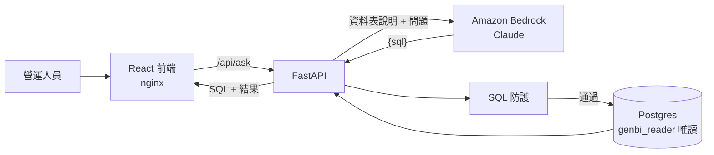

# BrewQL

**Find Coffee 營運數據助理**：讓不會寫 SQL 的營運人員用中文提問，系統透過 Amazon Bedrock 上的 Claude 產生 SQL，經多層防護後在唯讀資料庫執行，並把**實際執行的 SQL** 和結果一起呈現。

> 這是一個作品集專案。資料表結構沿用 Find Coffee（咖啡店搜尋服務），**所有資料都是模擬產生的**，不含任何真實使用者資料。

## 設計重點

- **模型看不到資料**：送給 Bedrock 的只有資料表說明和問題；SQL 在我們自己的資料庫執行，結果直接回到前端。
- **防護分層**：真正的安全邊界是資料庫唯讀角色，SQL 驗證是第二道防線。

  | 層 | 做法 | 狀態 |
  |---|---|---|
  | 資料庫角色 | `genbi_reader` 只有 `SELECT`，預設 read-only transaction、5 秒逾時 | ✅ |
  | SQL 驗證 | sqlglot 解析整棵語法樹：只允許單一 SELECT，CTE、`SELECT INTO` 中的寫入也會被擋 | ✅ |
  | 資料表白名單、敏感欄位、危險函式 | 只能查 `cafes`（CTE 依作用範圍判斷）；擋 `pg_catalog`、`line_user_id`、`pg_sleep`、`dblink` 等 | ✅ |
  | 執行限制 | 外層 `LIMIT` 最多 1000；每個查詢 `SET LOCAL statement_timeout` 5 秒 | ✅ |
  | Bedrock Guardrails（輸入過濾） | | ticket 3 |

- **結構化輸出**：模型必須回傳符合 JSON schema 的 `{"sql": "..."}`；截斷、拒答、格式不符都不會執行任何查詢。
- **不阻塞事件迴圈**：Bedrock SDK 是同步的，以 `asyncio.to_thread` 執行；資料庫用原生 async 的 asyncpg。
- **以數據做決策**：後續 ticket 會用 golden set 量測正確率、延遲與成本，比較模型與 RAG 的效果。

## 架構



| 目錄 | 內容 |
|---|---|
| `backend/` | FastAPI、Bedrock 呼叫、SQL 防護、唯讀執行器（`app/`）；smoke 腳本（`scripts/`）；測試（`tests/`） |
| `frontend/` | Vite + React + TypeScript；正式環境由 nginx 提供並轉發 `/api` |
| `db/init/` | Postgres 首次啟動時執行：schema、200 家示範咖啡店（固定亂數種子）、唯讀角色 |
| `openspec/` | 每個功能的 proposal、spec、design、tasks |
| `tools/` | CI 用的 spec 一致性檢查 |

## 本機啟動

需要：Docker、一組可以呼叫 Bedrock Claude 模型的 AWS 憑證（見下方）。

```bash
cp .env.example .env
# 編輯 .env：設定 POSTGRES_PASSWORD、GENBI_READER_PASSWORD（兩組不同，避免 : @ /）
#           以及 AWS_PROFILE、BEDROCK_MODEL_ID

docker compose up --build
```

| 服務 | 網址 |
|---|---|
| 網頁 | http://localhost:8080 |
| API | http://localhost:8000（`GET /health`、`POST /api/ask`） |
| 資料庫 | `localhost:${DB_PORT}`（預設 5432） |

```bash
curl -s -X POST localhost:8000/api/ask -H 'content-type: application/json' \
  -d '{"question":"台北市有幾家咖啡店？"}'
# {"status":"ok","sql":"SELECT COUNT(*) ... WHERE city = '台北市'","columns":["count"],"rows":[[160]],...}
```

- 本機已有 Postgres 佔用 5432 時，把 `.env` 的 `DB_PORT` 改成其他 port。
- 重建示範資料庫：`docker compose down -v`（資料以固定種子產生，重建後完全相同）。

### Bedrock 憑證

1. 建立只允許 `bedrock:InvokeModel` 的 IAM user（或使用 IAM Identity Center），以 `aws configure --profile brewql` 存入本機。
2. 在 Bedrock 模型目錄確認帳號可使用的 Claude 模型與 ID，填入 `.env`：

   ```bash
   AWS_PROFILE=brewql
   AWS_REGION=us-east-1
   BEDROCK_MODEL_ID=us.anthropic.claude-haiku-4-5-20251001-v1:0
   BEDROCK_EFFORT=          # Claude 4.6 以前的模型不支援 effort，留空；Haiku 5.5 可設 low
   ```

3. 不啟動整個服務，直接測試 Bedrock：

   ```bash
   AWS_PROFILE=brewql uv --directory backend run python -m scripts.ask "台北市有幾家咖啡店？"
   ```

憑證只存在本機 `~/.aws`，以唯讀方式掛進容器，不會進入 repo 或 image。

## 開發

```bash
# 後端
uv --directory backend sync --group dev
uv --directory backend run pytest -q          # 單元測試；設定 TEST_DATABASE_URL 時一併跑整合測試
uv --directory backend run ruff check .

# 前端
npm --prefix frontend install
npm --prefix frontend test
npm --prefix frontend run build
```

- 以 TDD 開發：每個行為先有失敗的測試，再寫實作。單元測試不呼叫 Bedrock 或其他外部服務。
- CI（GitHub Actions）在每個 PR 執行 `backend`（ruff + pytest，含真實 Postgres 整合測試）、`frontend`（oxlint + Vitest + build）與 `spec-check`（程式碼變更必須伴隨 `openspec/` 變更），三者皆為合併前的必要條件。
- 分支：`main` 可部署、`develop` 開發主線，皆只能透過 PR 合併；每個 OpenSpec change 一個 `feature/<change-name>` 分支。

## 進度

以垂直切分的 ticket 逐步完成，每個 ticket 對應 `openspec/changes/` 下的一個 change。

| # | Change | 內容 |
|---|---|---|
| 1 | `ask-first-question` | 中文提問 → Bedrock 產生 SQL → 唯讀執行 → 表格 ✅ |
| 2 | `block-unsafe-sql` | 白名單、LIMIT、逾時、危險函式與欄位（進行中） |
| 3 | `refuse-and-clarify` | 拒答與反問、Bedrock Guardrails |
| 4 | `self-correct-on-error` | SQL 錯誤時帶錯誤訊息重試 |
| 5 | `eval-golden-set` | 以執行結果比對的正確率評估 |
| 6–8 | 圖表與洞察 | 搜尋趨勢、行政區供需落差、收藏洞察 |
| 9 | `rag-knowledge-base` | Titan Embeddings + pgvector 檢索 schema、名詞與範例 |
| 10–12 | 編輯 SQL、步驟串流、模型比較報告 | |
| 13 | `deploy-public-demo` | Terraform 部署 EC2、IAM role、預算警報 |
| — | `record-audit-log`、`import-real-cafes` | 稽核紀錄（DB + CloudWatch）、匯入真實店家（選做） |
