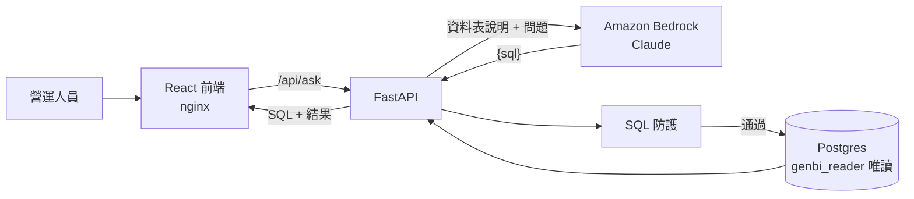
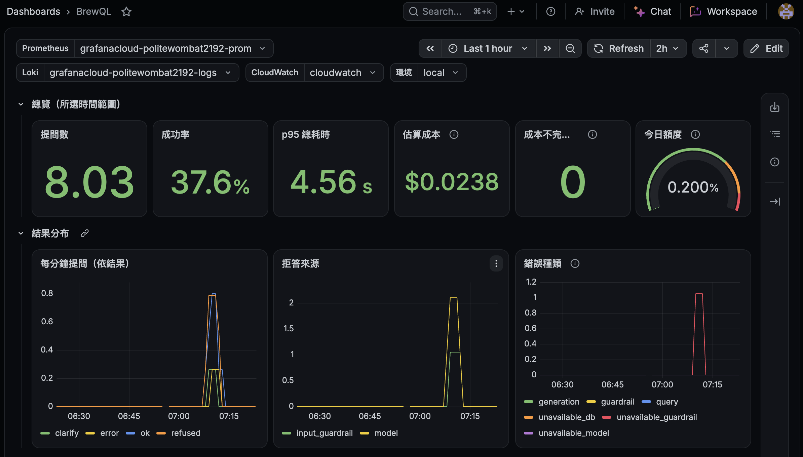
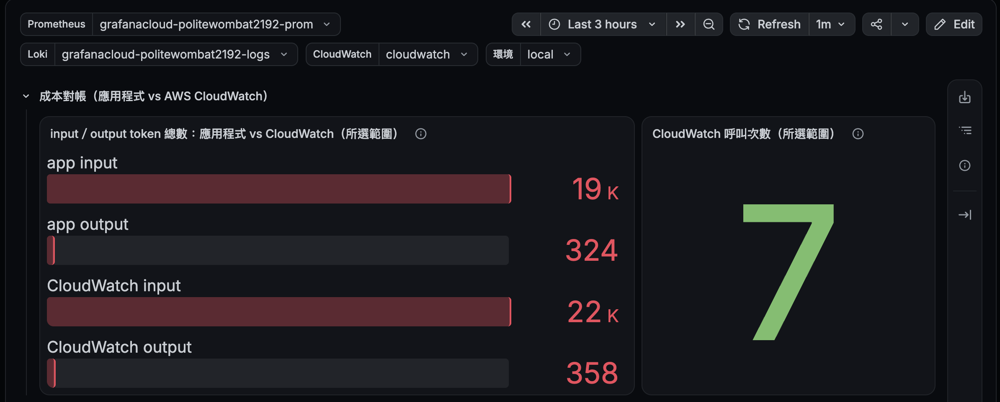

# BrewQL

**Find Coffee 營運數據助理**：讓不會寫 SQL 的營運人員用中文提問，系統透過 Amazon Bedrock 上的 Claude 產生 SQL，經多層防護後在唯讀資料庫執行，並把**實際執行的 SQL** 和結果一起呈現。

> 這是一個作品集專案。資料表結構沿用 Find Coffee（咖啡店搜尋服務），**所有資料都是模擬產生的**，不含任何真實使用者資料。

## 設計重點

- **模型看不到資料**：送給 Bedrock 的只有資料表說明和問題；SQL 在我們自己的資料庫執行，結果直接回到前端。
- **防護分層**：問題先經輸入防護與模型判斷，產生的 SQL 再經 SQL 驗證與執行限制；真正的安全邊界是資料庫唯讀角色。任何一層被繞過，下一層仍然有效。

  | 層 | 做法 | 狀態 |
  |---|---|---|
  | 資料庫角色 | `genbi_reader` 只有 `SELECT`，預設 read-only transaction、5 秒逾時 | ✅ |
  | SQL 驗證 | sqlglot 解析整棵語法樹：只允許單一 SELECT，CTE、`SELECT INTO` 中的寫入也會被擋 | ✅ |
  | 資料表白名單、敏感欄位、危險函式 | 只能查 `cafes`（CTE 依作用範圍判斷）；擋 `pg_catalog`、`line_user_id`、`pg_sleep`、`dblink` 等 | ✅ |
  | 執行限制 | 外層 `LIMIT` 最多 1000；每個查詢 `SET LOCAL statement_timeout` 5 秒 | ✅ |
  | Bedrock Guardrails（輸入防護） | 問題進入模型前檢查 prompt attack 與無關話題（Standard 方案，支援中文）；呼叫失敗回 502，不跳過檢查 | ✅ |
  | 模型判斷 | 修改資料、預測未來、讀取未開放資料 → 拒答；缺少時間範圍或指標 → 反問；兩者都不執行 SQL | ✅ |

- **IAM 依職責分開**：API 執行時用的 `brewql` 只能呼叫模型與套用 Guardrail；建立、修改 Guardrail 由只在部署時使用的 `brewql-deployer` 負責。使用防護的身分不能修改防護，金鑰外洩也無法關掉檢查（見 `openspec/changes/refuse-and-clarify/design.md` D9）。
- **結構化輸出**：模型必須回傳符合 JSON schema 的 `{"kind": "sql" | "refuse" | "clarify", "sql", "message"}`；只有 `kind=sql` 會執行查詢，截斷、格式不符、類型與內容不一致都不會執行。畫面會分別顯示拒答（並標示輸入防護或模型判斷）與反問。
- **不阻塞事件迴圈**：Bedrock SDK 是同步的，以 `asyncio.to_thread` 執行；資料庫用原生 async 的 asyncpg。
- **以數據做決策**：後續 ticket 會用 golden set 量測正確率、延遲與成本，比較模型與 RAG 的效果。

## 架構



| 目錄 | 內容 |
|---|---|
| `backend/` | FastAPI、Bedrock 呼叫、SQL 防護、唯讀執行器（`app/`）；smoke 腳本（`scripts/`）；測試（`tests/`） |
| `frontend/` | Vite + React + TypeScript；正式環境由 nginx 提供並轉發 `/api` |
| `db/init/` | Postgres 首次啟動時執行：schema、200 家示範咖啡店（固定亂數種子）、唯讀角色 |
| `openspec/` | 每個功能的 proposal、spec、design、tasks |
| `tools/` | CI 用的 spec 一致性檢查 |

## 本機啟動

需要：Docker、一組可以呼叫 Bedrock Claude 模型的 AWS 憑證（見下方）。

```bash
cp .env.example .env
# 編輯 .env：設定 POSTGRES_PASSWORD、GENBI_READER_PASSWORD（兩組不同，避免 : @ /）
#           以及 AWS_PROFILE、BEDROCK_MODEL_ID

docker compose up --build
```

| 服務 | 網址 |
|---|---|
| 網頁 | http://localhost:8080 |
| API | http://localhost:8000（`GET /health`、`POST /api/ask`） |
| 資料庫 | `localhost:${DB_PORT}`（預設 5434） |

```bash
curl -s -X POST localhost:8000/api/ask -H 'content-type: application/json' \
  -d '{"question":"台北市有幾家咖啡店？"}'
# {"status":"ok","sql":"SELECT COUNT(*) ... WHERE city = '台北市'","columns":["count"],"rows":[[160]],...}
```

- 資料庫預設發布在 5434，避開本機其他專案常用的 5432；要改就改 `.env` 的 `DB_PORT`，`DATABASE_URL` 的 port 也要一起改。
- 重建示範資料庫：`docker compose down -v`（資料以固定種子產生，重建後完全相同）。

### Bedrock 憑證

1. 建立只允許 `bedrock:InvokeModel` 的 IAM user（或使用 IAM Identity Center），以 `aws configure --profile brewql` 存入本機。
   輸入防護（Bedrock Guardrails）另外需要部署用的 `brewql-deployer` 執行 `terraform apply`，再把輸出的 `apply_guardrail_policy_json` 掛到 `brewql`；未設定 `BEDROCK_GUARDRAIL_ID` 時跳過輸入檢查（僅限本機開發）。
2. 在 Bedrock 模型目錄確認帳號可使用的 Claude 模型與 ID，填入 `.env`：

   ```bash
   AWS_PROFILE=brewql
   AWS_REGION=us-east-1
   BEDROCK_MODEL_ID=us.anthropic.claude-haiku-4-5-20251001-v1:0
   BEDROCK_EFFORT=          # Claude 4.6 以前的模型不支援 effort，留空；Haiku 5.5 可設 low
   ```

3. 不啟動整個服務，直接測試 Bedrock：

   ```bash
   AWS_PROFILE=brewql uv --directory backend run python -m scripts.ask "台北市有幾家咖啡店？"
   ```

憑證只存在本機 `~/.aws`，以唯讀方式掛進容器，不會進入 repo 或 image。

## 監控

backend 輸出 JSON log 與 Prometheus 指標（`/metrics` 只在 compose 網路內，nginx 對外回 404），由 Grafana Alloy 連同 nginx access log、主機與容器資源推送到 Grafana Cloud。Dashboard 與告警規則以程式碼存在 `observability/`，設定步驟與每個面板的意涵見 [observability/README.md](observability/README.md#dashboard-導覽)。



成本有兩個來源：應用程式依 `backend/app/pricing.py` 估算，並與 AWS CloudWatch `AWS/Bedrock` 的 token 數並排對帳。Grafana 以 Terraform 建立的唯讀 IAM role 讀取 CloudWatch，沒有 access key。



## 開發

```bash
# 後端
uv --directory backend sync --group dev
uv --directory backend run pytest -q          # 單元測試；設定 TEST_DATABASE_URL 時一併跑整合測試
uv --directory backend run ruff check .

# 前端
npm --prefix frontend install
npm --prefix frontend test
npm --prefix frontend run build
```

- 以 TDD 開發：每個行為先有失敗的測試，再寫實作。單元測試不呼叫 Bedrock 或其他外部服務。
- CI（GitHub Actions）在每個 PR 執行 `backend`（ruff + pytest，含真實 Postgres 整合測試）、`frontend`（oxlint + Vitest + build）與 `spec-check`（程式碼變更必須伴隨 `openspec/` 變更），三者皆為合併前的必要條件。
- 分支：`main` 可部署、`develop` 開發主線，皆只能透過 PR 合併；每個 OpenSpec change 一個 `feature/<change-name>` 分支。

## 進度

以垂直切分的 ticket 逐步完成，每個 ticket 對應 `openspec/changes/` 下的一個 change。

| 順序 | # | Change | 內容 |
|---|---|---|---|
| 1 | 1 | `ask-first-question` | 中文提問 → Bedrock 產生 SQL → 唯讀執行 → 表格 ✅ |
| 2 | 2 | `block-unsafe-sql` | 白名單、LIMIT、逾時、危險函式與欄位 ✅ |
| 3 | 3 | `refuse-and-clarify` | 拒答與反問、Bedrock Guardrails ✅ |
| 4 | 4 | `self-correct-on-error` | SQL 錯誤時帶錯誤訊息重試（最多 1 次） ✅ |
| 5 | 5 | `eval-golden-set` | 以執行結果比對的正確率評估（基準 14/15，加上今天日期後 15/15） ✅ |
| 6 | 6 | `search-trend-line-chart` | 模擬會員與搜尋紀錄、折線圖（評估 18/18） ✅ |
| 7 | 7 | `district-gap-bar-chart` | 行政區供需落差、長條圖與數字卡（評估 21/21） ✅ |
| 8 | 8 | `view-favorite-insights` | 瀏覽、收藏與社群評分、收藏轉換率；RAG 前的最終評估基準（26/26） ✅ |
| 9 | — | `limit-public-traffic` | nginx 只轉發 `/api/ask`、每 IP 限流與連線上限、全域每日提問上限（皆為環境變數） ✅ |
| 10 | — | `observe-with-grafana` | JSON log、Prometheus 指標、Grafana Alloy → Grafana Cloud；dashboard、告警、成本對帳 |
| 11 | — | `record-audit-log` | 稽核紀錄（DB + Grafana Loki），紀錄只供管理者查看 |
| 12 | 13 | `deploy-public-demo` | Terraform 部署 EC2、IAM role、預算警報 |
| 13 | 9 | `rag-knowledge-base` | Titan Embeddings + pgvector 檢索 schema、名詞與範例 |
| 14 | — | `import-real-cafes` | 匯入真實店家（Find Coffee 店家、屬性投票彙總、Cafe Nomad），與模擬資料兩種模式並存 |
| 15 | — | `import-open-data` | 公開資料第一階段：行政區人口、大專校院（以行政區串接） |
| 16 | — | `import-open-data` | 公開資料第二階段：YouBike 站點、捷運出入口與進出人次（距離預先計算） |
| 17 | 10 | `edit-and-rerun-sql` | 編輯 SQL 後重新執行（同樣經過 SQL 防護） |
| 18 | 11 | `show-definitions-and-steps` | 顯示本次使用的名詞定義；LangGraph 流程與 SSE 步驟串流 |
| 19 | 12 | `model-comparison-report` | 模型比較報告：Haiku 與 Sonnet、錯誤分類與改善、prompt caching 成本優化 |

依「順序」由上而下執行，`#` 是原始 ticket 編號（文件與程式註解中的「ticket 9」等指此編號）：

- 先在本機完成評估與圖表，再補齊公開前必要的限流、監控與稽核後部署；之後的 ticket 完成時重新部署即可。
- RAG 排在匯入真實與公開資料之前：資料表變多後 schema 說明與成本會持續上升，先有檢索才能證明資料增加而成本不暴增。
- 模型比較報告放最後，等 RAG 與真實資料都完成，比較的面向最完整。
- Prompt caching 列入考量：每題都帶約 3,000 tokens 相同的 schema 說明，快取這段前綴可降低輸入成本與延遲，且不會有答案過期問題（不同於答案快取）。待 `record-audit-log` 有實際重複率與 token 數據、RAG 定下 prompt 結構後評估，並先確認 Haiku 可快取的最短 prompt 長度。
