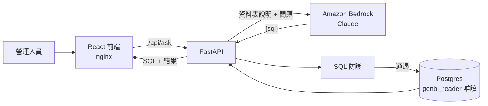

# BrewQL

**Find Coffee 營運數據助理**：讓不會寫 SQL 的營運人員用中文提問，系統透過 Amazon Bedrock 上的 Claude 產生 SQL，經多層防護後在唯讀資料庫執行，並把**實際執行的 SQL** 和結果一起呈現。

> 這是一個作品集專案。資料表結構沿用 Find Coffee（咖啡店搜尋服務），**所有資料都是模擬產生的**，不含任何真實使用者資料。

## 設計重點

- **模型看不到資料**：送給 Bedrock 的只有資料表說明和問題；SQL 在我們自己的資料庫執行，結果直接回到前端。
- **防護分層**：問題先經輸入防護與模型判斷，產生的 SQL 再經 SQL 驗證與執行限制；真正的安全邊界是資料庫唯讀角色。任何一層被繞過，下一層仍然有效。

  | 層 | 做法 | 狀態 |
  |---|---|---|
  | 資料庫角色 | `genbi_reader` 只有 `SELECT`，預設 read-only transaction、5 秒逾時 | ✅ |
  | SQL 驗證 | sqlglot 解析整棵語法樹：只允許單一 SELECT，CTE、`SELECT INTO` 中的寫入也會被擋 | ✅ |
  | 資料表白名單、敏感欄位、危險函式 | 只能查 `cafes`（CTE 依作用範圍判斷）；擋 `pg_catalog`、`line_user_id`、`pg_sleep`、`dblink` 等 | ✅ |
  | 執行限制 | 外層 `LIMIT` 最多 1000；每個查詢 `SET LOCAL statement_timeout` 5 秒 | ✅ |
  | Bedrock Guardrails（輸入防護） | 問題進入模型前檢查 prompt attack 與無關話題（Standard 方案，支援中文）；呼叫失敗回 502，不跳過檢查 | ✅ |
  | 模型判斷 | 修改資料、預測未來、讀取未開放資料 → 拒答；缺少時間範圍或指標 → 反問；兩者都不執行 SQL | ✅ |

- **IAM 依職責分開**：API 執行時用的 `brewql` 只能呼叫模型與套用 Guardrail；建立、修改 Guardrail 由只在部署時使用的 `brewql-deployer` 負責。使用防護的身分不能修改防護，金鑰外洩也無法關掉檢查（見 `openspec/changes/refuse-and-clarify/design.md` D9）。
- **結構化輸出**：模型必須回傳符合 JSON schema 的 `{"kind": "sql" | "refuse" | "clarify", "sql", "message"}`；只有 `kind=sql` 會執行查詢，截斷、格式不符、類型與內容不一致都不會執行。畫面會分別顯示拒答（並標示輸入防護或模型判斷）與反問。
- **不阻塞事件迴圈**：Bedrock SDK 是同步的，以 `asyncio.to_thread` 執行；資料庫用原生 async 的 asyncpg。
- **以數據做決策**：後續 ticket 會用 golden set 量測正確率、延遲與成本，比較模型與 RAG 的效果。

## 架構



| 目錄 | 內容 |
|---|---|
| `backend/` | FastAPI、Bedrock 呼叫、SQL 防護、唯讀執行器（`app/`）；smoke 腳本（`scripts/`）；測試（`tests/`） |
| `frontend/` | Vite + React + TypeScript；正式環境由 nginx 提供並轉發 `/api` |
| `db/init/` | Postgres 首次啟動時執行：schema、200 家示範咖啡店（固定亂數種子）、唯讀角色 |
| `openspec/` | 每個功能的 proposal、spec、design、tasks |
| `tools/` | CI 用的 spec 一致性檢查 |

## 本機啟動

需要：Docker、一組可以呼叫 Bedrock Claude 模型的 AWS 憑證（見下方）。

```bash
cp .env.example .env
# 編輯 .env：設定 POSTGRES_PASSWORD、GENBI_READER_PASSWORD、GENBI_AUDIT_WRITER_PASSWORD、
#           GENBI_KNOWLEDGE_WRITER_PASSWORD（四組不同，避免 : @ /）、AUDIT_IP_HMAC_KEY（openssl rand -hex 32）
#           以及 AWS_PROFILE、BEDROCK_MODEL_ID

docker compose up --build

# up 會先執行 knowledge-import：把 backend/knowledge/*.yaml 向量化寫入 pgvector（Titan Embeddings，
# 首次約 $0.0001，內容沒變不重算）。知識文件打包在 image 裡，修改後要加 --build 才會匯入新內容：
docker compose run --rm --build knowledge-import
```

| 服務 | 網址 |
|---|---|
| 網頁 | http://localhost:8080 |
| API | http://localhost:8000（`GET /health`、`POST /api/ask`） |
| 資料庫 | `localhost:${DB_PORT}`（預設 5434） |

```bash
curl -s -X POST localhost:8000/api/ask -H 'content-type: application/json' \
  -d '{"question":"台北市有幾家咖啡店？"}'
# {"status":"ok","sql":"SELECT COUNT(*) ... WHERE city = '台北市'","columns":["count"],"rows":[[160]],...}
```

- 資料庫預設發布在 5434，避開本機其他專案常用的 5432；要改就改 `.env` 的 `DB_PORT`，`DATABASE_URL` 的 port 也要一起改。
- 重建示範資料庫：`docker compose down -v`（資料以固定種子產生，重建後完全相同；稽核紀錄會一併清除）。
- 少了稽核設定 backend 會拒絕啟動；新增稽核資料表後，既有的本機資料庫要 `down -v` 重建才會有。
- 資料庫 volume 依資料集命名（`genbi_pgdata_demo`、`genbi_pgdata_real`）；更早建立的 `genbi_pgdata` 已不再使用，可用 `docker volume rm genbi_pgdata` 刪除。

### 資料集：demo 與 real

`DATASET` 決定資料庫裡是哪一套資料，兩套各用自己的 volume，切換不會互相覆蓋：

- `demo`（預設）：200 家示範店家與模擬的會員、搜尋、瀏覽、收藏，以固定種子產生。評估與 CI 只用這一套，評估遇到其他資料會在呼叫 Bedrock 前停止。
- `real`：Find Coffee 的真實店家，只限台北市、新北市，搭配同樣以模擬方式產生的會員與行為資料。只在本機使用，不部署。

```bash
# 切到 real：REAL_DATA_DIR 是放 pgAdmin 匯出檔的資料夾（repo 外），需要三個檔案：
# cafes*.csv、cafe_cafeattributevote*.csv、cafe_nomad_cache*.csv
DATASET=real REAL_DATA_DIR="/path/to/exports" docker compose up --build
# 首次啟動由 cafe-import 匯入，印出匯入報告（解析、補上、排除的家數、Cafe Nomad 比對數）；
# 之後再啟動會略過。匯出檔更新時，重建 real 資料庫再啟動：
DATASET=real docker compose down -v

# 切回 demo
docker compose up
```

real 只匯入公開的店家資訊：

- 匯入：店名、地址、城市與行政區（由地址解析，解析不出來時沿用 1 公里內最近店家）、評分、評論數、插座、限時、寵物欄位、`place_id`，以及 google 與 Cafe Nomad 來源的屬性投票。
- 不匯入：任何會員資料與行為（搜尋、瀏覽、收藏、會員投票），以及收藏數、瀏覽數這類由會員行為彙總的數字；評論原文、照片、AI 摘要、電話、網站、營業時間。
- Cafe Nomad 資料以座標（50 公尺內）與店名比對對應店家，對不到的捨棄；real 有社群評分的店家約兩成，demo 是七成。

資料來源與限制：

- 店家資料來自 Google Places（經 Find Coffee 取得），依 Google Maps Platform 條款不得散布，只能留在本機的 real 資料庫。匯出檔放在 repo 外；`db/import/` 已列入 `.gitignore`。
- Cafe Nomad（[cafenomad.tw](https://cafenomad.tw)）的資料沒有查到正式的授權條款，只在本機使用。
- real 的資料比 demo 稀疏（例如寵物欄位大多未知），分布也不同，回答只供展示，不作為評估依據。

### 公開資料

兩種資料集都會載入政府公開資料的快照，以行政區和店家、搜尋資料串接，可以問「每萬人咖啡店數」「有大專校院的行政區」「捷運站多的區有幾家店」這類問題。只收台北市、新北市。

| 資料表 | 來源 | 資料時間 |
|---|---|---|
| `district_population`（人口、土地面積） | 內政部戶政司「各鄉鎮市區人口密度」（[data.gov.tw/dataset/8410](https://data.gov.tw/dataset/8410)） | 民國 114 年底 |
| `universities`（學校代碼、名稱、公私立、體制、行政區） | 教育部「全國大學校院名錄」（[data.gov.tw/dataset/33207](https://data.gov.tw/dataset/33207)） | 108 學年度（官方之後沒有更新，少數學校可能已合併或改名） |
| `youbike_stations`（營運中的 YouBike 2.0 站點、車柱數、座標） | 臺北市政府交通局「YouBike2.0臺北市公共自行車即時資訊」（[data.gov.tw/dataset/137993](https://data.gov.tw/dataset/137993)）、新北市政府交通局「新北市公共自行車租賃系統(YouBike2.0)」（[data.gov.tw/dataset/146969](https://data.gov.tw/dataset/146969)） | 下載日 2026-11-11（即時資料，`as_of` 記下載日） |
| `mrt_stations`（臺北捷運車站、出入口數、座標） | 臺北大眾捷運公司「臺北捷運車站出入口座標」（[data.gov.tw/dataset/128428](https://data.gov.tw/dataset/128428)） | 下載日 2026-11-11 |

- 授權：[政府資料開放授權條款第 1 版](https://data.gov.tw/license)，可以散布，需標示來源。
- 快照在 `db/init/open_data/`，由 `06_open_data.sh` 在資料庫初始化時載入。既有資料庫要 `docker compose down -v` 重建才會有新的資料表。
- 快照不收個人資訊：大專校院名錄的校長姓名、電話、傳真、地址都不收。
- YouBike 只收營運中的站，不收可借車輛等即時欄位；「臺大公館校區」的站算在大安區。
- 捷運資料只有出入口：同站出入口合成一列，位置取平均；檔案沒有行政區，取最近 YouBike 站的行政區，7 個位在行政區交界的車站以對照表修正（`MRT_DISTRICT_FIXES`，已和捷運官網的車站地址逐站核對）。只有臺北捷運公司的路網，不含機場捷運與輕軌。
- 學校代碼照官方下載檔保留；檔案裡數字代碼的前導 0 已經不見（例如政大是 `1`），不是正式的四碼格式。
- 官方更新時重產快照（下載檔放 repo 外；同樣的下載檔與下載日重跑，結果不變）：

```bash
curl -L -o /tmp/population.csv "https://opdadm.moi.gov.tw/api/v1/no-auth/resource/api/dataset/D1450798-F85B-4063-9761-A24B8929A684/resource/B7938B44-1E42-4ED2-A980-31629877B152/download"
curl -L -o /tmp/universities.csv "https://ws.moe.edu.tw/001/Upload/4/relfile/0/5038/55f39b31-27a0-4009-866a-ea260eb45eaf.csv"
curl -L -o /tmp/youbike_taipei.json "https://tcgbusfs.blob.core.windows.net/dotapp/youbike/v2/youbike_immediate.json"
curl -L -o /tmp/youbike_new_taipei.json "https://data.ntpc.gov.tw/api/datasets/010e5b15-3823-4b20-b401-b1cf000550c5/json?page=0&size=3000"
curl -L -o /tmp/mrt_exits.csv "https://data.taipei/api/dataset/cfa4778c-62c1-497b-b704-756231de348b/resource/307a7f61-e302-4108-a817-877ccbfca7c1/download"
# 最後一個日期參數是 YouBike 與捷運檔的下載日，寫進 as_of
uv --directory backend run python -m scripts.prepare_open_data /tmp/population.csv /tmp/universities.csv \
  /tmp/youbike_taipei.json /tmp/youbike_new_taipei.json /tmp/mrt_exits.csv 2026-11-11 ../db/init/open_data
```

### Bedrock 憑證

1. 建立只允許 `bedrock:InvokeModel` 的 IAM user（或使用 IAM Identity Center），以 `aws configure --profile brewql` 存入本機。
   輸入防護（Bedrock Guardrails）另外需要部署用的 `brewql-deployer` 執行 `terraform apply`，再把輸出的 `apply_guardrail_policy_json` 掛到 `brewql`；未設定 `BEDROCK_GUARDRAIL_ID` 時跳過輸入檢查（僅限本機開發）。
2. 在 Bedrock 模型目錄確認帳號可使用的 Claude 模型與 ID，填入 `.env`：

   ```bash
   AWS_PROFILE=brewql
   AWS_REGION=us-east-1
   BEDROCK_MODEL_ID=us.anthropic.claude-haiku-4-5-20251001-v1:0
   BEDROCK_EFFORT=          # Claude 4.6 以前的模型不支援 effort，留空；Haiku 5.5 可設 low
   ```

3. 不啟動整個服務，直接測試 Bedrock：

   ```bash
   AWS_PROFILE=brewql uv --directory backend run python -m scripts.ask "台北市有幾家咖啡店？"
   ```

憑證只存在本機 `~/.aws`，以唯讀方式掛進容器，不會進入 repo 或 image。

## 監控

backend 輸出 JSON log 與 Prometheus 指標（`/metrics` 只在 compose 網路內，nginx 對外回 404），由 Grafana Alloy 連同 nginx access log、主機與容器資源推送到 Grafana Cloud。Dashboard 與告警規則以程式碼存在 `observability/`，設定步驟與每個面板的意涵見 [observability/README.md](observability/README.md#dashboard-導覽)。


成本有兩個來源：應用程式依 `backend/app/pricing.py` 估算，並與 AWS CloudWatch `AWS/Bedrock` 的 token 數並排對帳。Grafana 以 Terraform 建立的唯讀 IAM role 讀取 CloudWatch，沒有 access key。


## 稽核

每一次 `/api/ask` 提問（成功、反問、拒答、錯誤，含 5xx）在回應前留下一筆紀錄：問題原文、產生的 SQL、被拒的重試、結果、token 與估算成本、耗時、訪客。被 nginx 限流、每日上限擋下或格式錯誤的請求沒有進入答題流程，不記錄。

- **兩份紀錄**：資料庫 `ask_audit` 資料表（永久）與一行 `ask_audit` JSON log（送到 Grafana Cloud Loki，保存 14 天）。資料庫寫入失敗不影響回答，但會記錄錯誤、計入 `brewql_audit_write_failures_total` 並觸發告警，log 那一份仍在。
- **訪客**：來源 IP 的 HMAC-SHA256（金鑰 `AUDIT_IP_HMAC_KEY`）。看得出同一位訪客問了哪些題，但不儲存 IP。IP 由 nginx 以連線位址覆寫 `X-Real-IP`，使用者無法偽造。
- **權限分離**：寫入用的 `genbi_audit_writer` 只有 `INSERT`、`SELECT`，不能修改或刪除紀錄，也讀不到 `cafes`；查詢用的 `genbi_reader` 讀不到稽核表。
- **只給管理者**：公開網址沒有讀取紀錄的入口；提問畫面提醒使用者不要輸入個人資料。最近 14 天看 Grafana 的稽核 dashboard（見 [observability/README.md](observability/README.md#稽核-dashboard)），完整歷史用 psql 查資料庫：

```bash
# 本機
docker compose exec db psql -U genbi_owner -d genbi
# 部署環境：資料庫只綁主機的 127.0.0.1，先開 SSH tunnel 再連
ssh -N -L 5434:127.0.0.1:5434 <部署主機>
psql "postgresql://genbi_audit_writer@127.0.0.1:5434/genbi"
```

```sql
-- 最近 20 題
SELECT created_at, left(visitor, 8) AS visitor, status, coalesce(refusal_source, error_kind) AS reason,
       question, sql
FROM ask_audit ORDER BY created_at DESC LIMIT 20;

-- 某位訪客（visitor 開頭幾碼）的所有提問
SELECT created_at, status, question FROM ask_audit WHERE visitor LIKE '0f1488db%' ORDER BY created_at;

-- 每日題數、結果分布與估算成本（台北時間）
SELECT (created_at AT TIME ZONE 'Asia/Taipei')::date AS day, status, count(*), sum(estimated_cost_usd) AS usd
FROM ask_audit GROUP BY 1, 2 ORDER BY 1 DESC, 2;
```

## 開發

```bash
# 後端
uv --directory backend sync --group dev
uv --directory backend run pytest -q          # 單元測試；設定 TEST_DATABASE_URL 時一併跑整合測試
uv --directory backend run ruff check .

# 前端
npm --prefix frontend install
npm --prefix frontend test
npm --prefix frontend run build
```

- 以 TDD 開發：每個行為先有失敗的測試，再寫實作。單元測試不呼叫 Bedrock 或其他外部服務。
- CI（GitHub Actions）在每個 PR 執行 `backend`（ruff + pytest，含真實 Postgres 整合測試）、`frontend`（oxlint + Vitest + build）、`spec-check`（程式碼變更必須伴隨 `openspec/` 變更）與 `observability`（`alloy fmt`／`validate`、`promtool check rules`／`test rules`）；前三者為合併前的必要條件。
- 分支：`main` 可部署、`develop` 開發主線，皆只能透過 PR 合併；每個 OpenSpec change 一個 `feature/<change-name>` 分支。

## 進度

以垂直切分的 ticket 逐步完成，每個 ticket 對應 `openspec/changes/` 下的一個 change。

| 順序 | # | Change | 內容 |
|---|---|---|---|
| 1 | 1 | `ask-first-question` | 中文提問 → Bedrock 產生 SQL → 唯讀執行 → 表格 ✅ |
| 2 | 2 | `block-unsafe-sql` | 白名單、LIMIT、逾時、危險函式與欄位 ✅ |
| 3 | 3 | `refuse-and-clarify` | 拒答與反問、Bedrock Guardrails ✅ |
| 4 | 4 | `self-correct-on-error` | SQL 錯誤時帶錯誤訊息重試（最多 1 次） ✅ |
| 5 | 5 | `eval-golden-set` | 以執行結果比對的正確率評估（基準 14/15，加上今天日期後 15/15） ✅ |
| 6 | 6 | `search-trend-line-chart` | 模擬會員與搜尋紀錄、折線圖（評估 18/18） ✅ |
| 7 | 7 | `district-gap-bar-chart` | 行政區供需落差、長條圖與數字卡（評估 21/21） ✅ |
| 8 | 8 | `view-favorite-insights` | 瀏覽、收藏與社群評分、收藏轉換率；RAG 前的最終評估基準（26/26） ✅ |
| 9 | — | `limit-public-traffic` | nginx 只轉發 `/api/ask`、每 IP 限流與連線上限、全域每日提問上限（皆為環境變數） ✅ |
| 10 | — | `observe-with-grafana` | JSON log、Prometheus 指標、Grafana Alloy → Grafana Cloud；dashboard、告警、成本對帳 ✅ |
| 11 | — | `record-audit-log` | 稽核紀錄（DB + Grafana Loki），紀錄只供管理者查看 ✅ |
| 12 | 9 | `rag-knowledge-base` | Titan Embeddings + pgvector 檢索 schema、名詞與範例；預設改為 rag，每題輸入 token -27%（評估 26/26） ✅ |
| 13 | — | `import-real-cafes` | 匯入真實店家（Find Coffee 店家、屬性投票、Cafe Nomad，限台北市與新北市），`DATASET=demo\|real` 兩種模式並存 ✅ |
| 14 | — | `import-open-data` | 公開資料第一階段：行政區人口、大專校院（以行政區串接），每萬人咖啡店數；評估 static／rag 皆 29/29 ✅ |
| 15 | — | `import-transit-open-data` | 公開資料第二階段：YouBike 站點、捷運車站（以行政區串接）；評估 static／rag 皆 31/31 ✅ |
| 16 | — | `cafe-transit-distance` | 店家加上經緯度，預先計算到捷運站、YouBike 站的距離 |
| 17 | — | `compare-bedrock-knowledge-bases` | 同一知識文件與測試集比較 pgvector 與 Bedrock Knowledge Bases（實驗資源比完即銷毀）；自建與 AWS 託管方案取捨文件 |
| 18 | 11 | `show-definitions-and-steps` | 顯示本次使用的名詞定義；LangGraph 流程與 SSE 步驟串流 |
| 19 | 12 | `model-comparison-report` | 模型比較報告：Haiku 與 Sonnet、錯誤分類與改善、prompt caching 成本優化 |
| 20 | 10 | `edit-and-rerun-sql` | 編輯 SQL 後重新執行（同樣經過 SQL 防護） |
| 21 | 13 | `deploy-public-demo` | Terraform 部署 EC2、IAM role、預算警報 |

依「順序」由上而下執行，`#` 是原始 ticket 編號（文件與程式註解中的「ticket 9」等指此編號）：

- 先在本機完成評估、圖表與公開前必要的限流、監控與稽核；部署放在最後，等 RAG、真實資料匯入、prompt caching 與模型調校都完成再上線。
- RAG 排在匯入真實與公開資料之前：資料表變多後 schema 說明與成本會持續上升，先有檢索才能證明資料增加而成本不暴增。
- 模型比較報告放在部署前，等 RAG 與真實資料都完成，比較的面向最完整，調校結果直接帶上線。
- Bedrock Knowledge Bases 比較放在資料匯入之後：新資料表的知識文件補齊後，兩種方案比的是完整的知識庫。
- 編輯 SQL 後重新執行延後到部署前，先完成資料匯入與模型調校。
- Prompt caching 列入考量：static 模式每題都帶約 3,000 tokens 相同的 schema 說明，快取這段前綴可降低輸入成本與延遲，且不會有答案過期問題（不同於答案快取）。RAG 上線後（預設 rag，每題約 2,240 tokens），每題相同的前綴只剩回覆規則與白名單表名，檢索到的知識每題不同、無法快取，因此要先量測固定前綴長度是否達到最短快取長度，再與 static + caching 比較。重複率與每題 input token 已可從稽核 dashboard（「重複的問題」、「每題 input token」）取得；待 RAG 定下 prompt 結構、匯入真實資料後，在 `model-comparison-report` 評估並實作，並先確認 Haiku 可快取的最短 prompt 長度。
