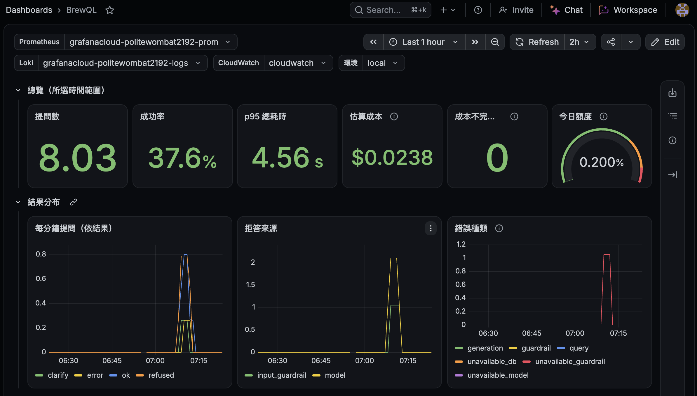
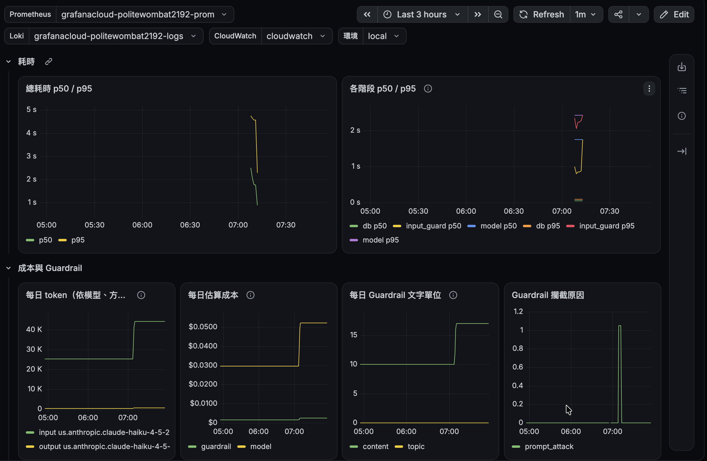
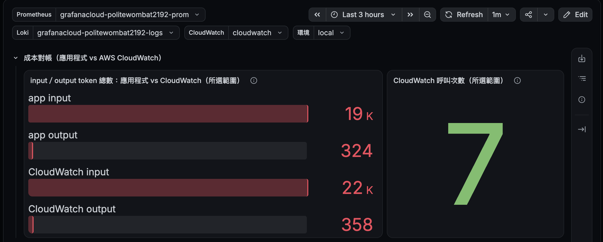
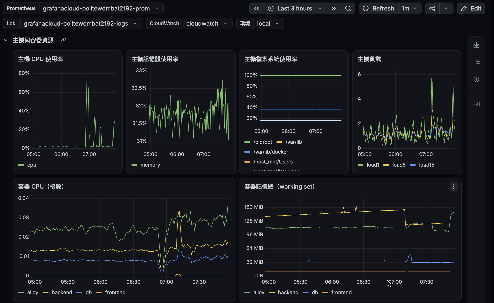
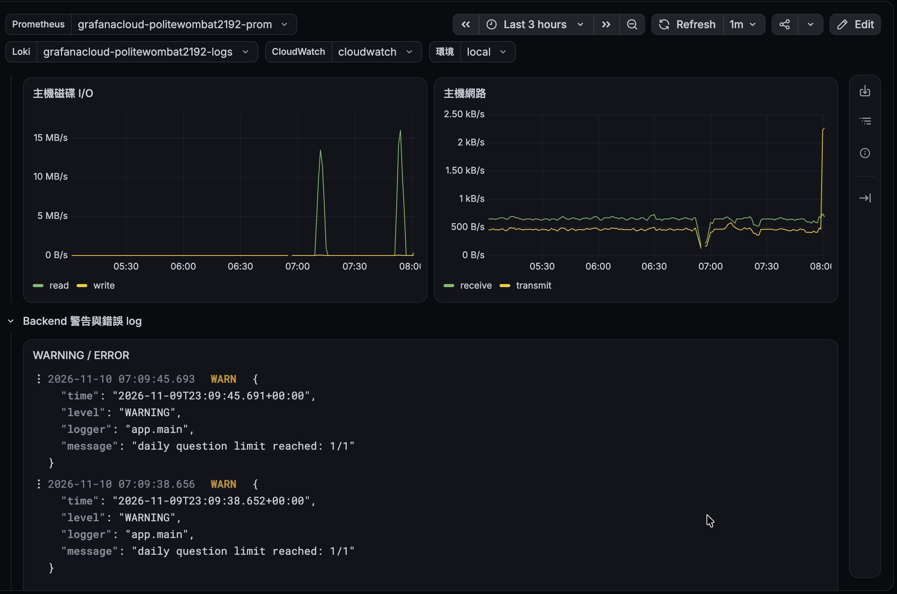
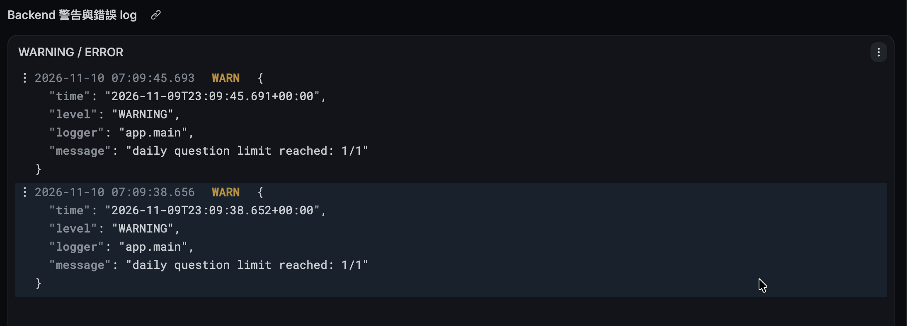

# Observability

BrewQL 的監控設定（OpenSpec change `observe-with-grafana`）。資料由 Grafana Alloy 推送到 Grafana Cloud，所有 log 與指標帶 `project="brewql"` 與 `env`（`local` 或 `demo`）。

```
observability/
├── alloy/config.alloy       # Alloy：backend /metrics、主機、容器、容器 log → Grafana Cloud
├── dashboards/brewql.json         # 營運 dashboard
├── dashboards/brewql-audit.json   # 稽核 dashboard（record-audit-log，只給管理者）
└── alerts/                        # 告警規則；tests/ 為 promtool 單元測試
```

## 啟動 Alloy

1. 在 `.env` 填入 `GRAFANA_CLOUD_*`（名稱見 `.env.example`）。token 只需要 `metrics:write` 與 `logs:write`。
2. `docker compose --profile observability up -d`
3. Alloy 的除錯介面：<http://127.0.0.1:12345>（只綁本機）。

不加 `--profile observability` 時 Alloy 不會啟動，其餘服務照常運作。

## 匯入 dashboard

1. Grafana Cloud → **Dashboards** → **New** → **Import**。
2. 上傳 `observability/dashboards/brewql.json`，資料夾選 `BrewQL`（沒有就先建立）。稽核 dashboard `brewql-audit.json` 以同樣方式匯入。
3. 匯入後在頁面上方選擇資料來源（`…-prom`、`…-logs`、CloudWatch）與環境（`local` 或 `demo`）。

在 UI 修改 dashboard 後，用 **Export** → **Export as JSON**（不勾 *Export for sharing externally*）覆蓋 repo 的檔案，再開 PR。

## 連接 CloudWatch（成本對帳）

Grafana Cloud 以 Assume Role 讀取 `AWS/Bedrock` 指標，不使用 access key。

1. **Connections** → **Data sources** → **Add new data source** → **CloudWatch**，Authentication Provider 選 **Grafana Assume Role**。頁面會顯示 Grafana 的 AWS 帳號 ID 與這個 stack 的 external ID。
2. 把兩個值寫進 `infra/terraform/terraform.tfvars`（已 git-ignore）的 `grafana_aws_account_id` 與 `grafana_external_id`，以 `brewql-deployer` 執行 `terraform apply`。建立的 `brewql-grafana-cloudwatch-read` 只能讀 CloudWatch 指標，trust policy 要求 external ID，其他 Grafana stack 無法使用。
3. 把輸出的 `grafana_cloudwatch_role_arn` 填入 Assume Role ARN，Default Region 選 `us-east-1`，**Save & test**。metrics 通過即可；logs 回 AccessDenied 是預期結果（role 沒有 `logs:*`）。

讀對帳面板時注意：

- 兩邊都來自 Bedrock 回應的 usage，原始數字相同。應用程式的數字由 Prometheus `increase()` 推算，會有小數與少量誤差；CloudWatch 約延遲數分鐘，並包含 eval 與 smoke 腳本的呼叫。
- backend 重啟後若在 Alloy 下一次抓取（15 秒）前就答題，且新的計數已超過重啟前的值，Prometheus 看不出計數器重置，該題 token 會少算。要精確比較時，用 Grafana Explore 查 CloudWatch `Sum`（period 300）與 backend `/metrics` 的原始計數。

## Dashboard 導覽

每一列回答一個營運問題。數字都帶 `project="brewql"` 與所選 `env`；除非標明，時間範圍跟著頁面右上角。

### 總覽：服務現在健康嗎？



| 面板 | 意涵 | 為什麼需要 |
|---|---|---|
| 提問數 | 所選範圍內 `/api/ask` 的題數（含拒答、反問、錯誤；不含被 nginx 或每日上限擋下的請求）。由 `increase()` 推算，可能出現小數 | 判斷流量規模，其他比例都以它為分母 |
| 成功率 | 回答成功（`status="ok"`）÷ 提問數。拒答與反問也算在分母，所以不是「錯誤率」的反面 | 一眼看出使用者有多少問題真的拿到答案；突然下降代表模型、Guardrail 或資料庫出問題 |
| p95 總耗時 | 95% 的題目在這個秒數內回答完 | 使用者感受的是慢的那一端；平均值會被快的題目掩蓋 |
| 估算成本 | 依 `backend/app/pricing.py` 單價算出的模型＋Guardrail 美元數 | 公開 Demo 按用量計費，要能隨時知道花了多少 |
| 成本不完整的題數 | 模型不在單價表，或 Guardrail 沒回報用量的題數 | 大於 0 代表估算成本偏低，該更新單價表，而不是誤以為很便宜 |
| 今日額度 | 今天已用題數 ÷ 每日上限，台北時間午夜歸零 | 接近 100% 時後面的使用者會收到 429；額度是防止帳單失控的最後一道閘門 |

### 結果分布：問題被怎麼處理？

| 面板 | 意涵 | 為什麼需要 |
|---|---|---|
| 每分鐘提問（依結果） | `ok`、`clarify`、`refused`、`error` 各自的每分鐘題數 | 看出流量高峰，以及哪一種結果在變多 |
| 拒答來源 | 被輸入防護（`input_guardrail`）或模型判斷（`model`）拒答的題數 | 輸入防護突增可能是有人在試 prompt attack；模型拒答突增可能是 prompt 或資料表說明需要調整 |
| 錯誤種類 | `unavailable_*` 是相依服務無法使用（5xx）；`generation`、`guardrail`、`query` 是答題過程失敗（重試後仍產生不出可執行的 SQL） | 5xx 要查基礎設施，答題失敗要查 prompt 與 SQL 防護，處理方向完全不同 |

### 耗時與成本：慢在哪、錢花在哪？



| 面板 | 意涵 | 為什麼需要 |
|---|---|---|
| 總耗時 p50 / p95 | 一般題目（p50）與慢的題目（p95）的回答時間 | p50 正常但 p95 很高，代表少數題目卡住（例如重試或慢查詢） |
| 各階段 p50 / p95 | 輸入防護（`input_guard`）、模型（`model`）、資料庫（`db`）各花多久；重試時每次呼叫各算一次 | 總耗時變慢時，直接看出是哪一段，不用翻 log |
| 每日 token（依模型、方向） | 過去 24 小時的 input／output token 滾動總數 | 成本主要來自 input token（資料表說明很長）；這是評估 prompt caching 或 RAG 縮短 prompt 的基準 |
| 每日估算成本 | 過去 24 小時的模型與 Guardrail 成本 | 分開兩個成本來源，知道該優化哪一邊 |
| 每日 Guardrail 文字單位 | topic 與 content 兩種 policy 各自計費的單位數（1 單位最多 1,000 字元） | Guardrail 按單位計費，長問題會用掉多個單位 |
| Guardrail 攔截原因 | 被擋下的原因，例如 `prompt_attack` | 知道使用者在嘗試什麼，判斷防護設定是否過嚴或過鬆 |

### 公開流量與成本對帳



| 面板 | 意涵 | 為什麼需要 |
|---|---|---|
| 429 與 404（每 5 分鐘） | nginx 限流擋下的請求（429），以及打白名單外路徑的請求（404） | 429 暴增代表有人大量呼叫；404 多代表有人在掃描 `/metrics`、`/docs` 等內部端點 |
| 被限流最多的來源 IP | 所選範圍內被 429 最多次的 IP | 找出濫用來源，決定要不要在安全群組層封鎖 |
| token 總數：應用程式 vs CloudWatch | 應用程式記錄的 token 和 AWS 端記錄的並排比較 | 應用程式的成本是自己估的；和 AWS 對帳才能證明沒有漏記呼叫（例如繞過指標的程式路徑） |
| CloudWatch 呼叫次數 | AWS 端記錄的 Bedrock 呼叫次數 | 每題大約 1 次模型呼叫（重試時 2 次），可以和提問數互相驗證 |

### 主機與容器資源：機器撐得住嗎？





| 面板 | 意涵 | 為什麼需要 |
|---|---|---|
| 主機 CPU、記憶體使用率 | 整台主機的使用比例 | Demo 跑在小台 EC2；記憶體超過 90% 會觸發告警，避免 OOM 讓整個服務停掉 |
| 主機檔案系統使用率 | 每個掛載點已用的比例 | 磁碟滿了 Postgres 和 Docker 都會壞；超過 85% 觸發告警 |
| 主機負載 | 1、5、15 分鐘平均的等待執行 process 數 | 和 CPU 核數比較，判斷是短暫尖峰還是持續過載 |
| 容器 CPU、記憶體 | `db`、`backend`、`frontend`、`alloy` 各自的用量 | 主機吃緊時找出是哪個容器；也看得出監控本身（`alloy`）佔了多少 |
| 主機磁碟 I/O、網路 | 每秒讀寫與收發的位元組數 | 磁碟 I/O 高可能是慢查詢；網路突增可能是流量攻擊。不收各容器的網路：需要讓 Alloy 開 `pid: host`，權限過大 |

本機 Docker Desktop 上的「主機」是 Docker 的 Linux VM，不是 Mac；主機數字要到部署的 EC2 才有意義。

### Backend 警告與錯誤 log



backend 等級為 WARNING 或 ERROR 的 JSON log，最新的在上面。指標告訴你「出事了」，log 告訴你「為什麼」：例如每日上限觸發、Guardrail 或 Bedrock 呼叫失敗的完整錯誤。log 不含問題原文。

## 稽核 dashboard

`brewql-audit.json` 讀 backend 每題一行的 `ask_audit` log（問題原文只出現在這種 log），只給管理者看；公開網址沒有任何讀取紀錄的入口。頁面上方可依狀態與訪客（visitor 開頭幾碼）篩選。

| 面板 | 意涵 | 為什麼需要 |
|---|---|---|
| 提問紀錄數、訪客數 | 所選範圍內的提問數，與不同 visitor（來源 IP 的 HMAC）數量 | 看出流量是少數人大量提問還是很多人各問幾題 |
| 稽核寫入失敗 | 沒寫進 `ask_audit` 資料表的提問數 | 大於 0 時那幾題只剩 Loki 這一份紀錄，要查稽核資料庫連線 |
| 估算成本 | `ask_audit` 的估算成本加總（單價未知的提問不計） | 與營運 dashboard 的估算成本互相對照 |
| 最近的提問 | 每題一列：時間、訪客、狀態、問題、SQL、拒答來源、錯誤種類、筆數、耗時、request id | 查某位訪客問了什麼、某個錯誤是哪一題；request id 可對到 backend 其他 log 與資料表 |
| 重複的問題 | 問題文字出現 2 次以上的次數與平均 input token | 評估快取答案或 prompt caching 是否值得做 |
| 每題 input token | 每題送給模型的 input token | 資料表說明佔了大部分，是 prompt caching 能省下的部分 |

### 兩份紀錄的保存與權限

| | Loki（`ask_audit` log） | 資料庫（`ask_audit` 資料表） |
|---|---|---|
| 保存期限 | 14 天（Free 方案；Pro 為 30 天），之後自動刪除 | 永久，沒有自動清除 |
| 誰能寫入 | Alloy token，scopes 只有 `logs:write`、`metrics:write` | `genbi_audit_writer`，只有 `INSERT`、`SELECT` |
| 誰能刪除 | 有 `logs:delete` 的 token；Alloy token 沒有，backend 主機被入侵也刪不掉 | 只有資料庫擁有者；寫入角色不能 `UPDATE`／`DELETE` |
| 用途 | 最近 14 天的 dashboard 與告警 | 完整歷史，管理者以 psql 查詢 |

查證（2026-11-10）：

- 保存期限與每月 50 GB 寫入上限見 [Grafana Cloud pricing](https://grafana.com/pricing/)；這個 stack 用 Free 方案，14 天已足夠，更早的紀錄查資料庫。
- `logs:read`、`logs:write`、`logs:delete` 是三個獨立的 scope，見 [access policies](https://grafana.com/docs/grafana-cloud/security-and-account-management/authentication-and-permissions/access-policies/)。Alloy 使用的 access policy 在 Grafana Cloud 後台確認只有 `logs:write` 與 `metrics:write`。
- 新建或輪換 Alloy token 時維持這兩個 scope；不要給 `logs:read`、`logs:delete`。

## 匯入告警規則

規則以 Prometheus rule 格式存在 `observability/alerts/`，匯入成 Grafana-managed alert rules：

1. **Alerting** → **Contact points**：建立通知管道（例如 email）。聯絡資訊只放在 Grafana，不進 repo。
2. **Alerting** → **Notification policies**：預設 policy 指向該 contact point。
3. **Alerting** → **Alert rules** → **Import to Grafana-managed rules**：
   - 來源選 **Prometheus YAML file**，上傳 `brewql-prometheus.yml`，資料來源選 `…-prom`，資料夾選 `BrewQL`。
   - 再匯入一次 `brewql-loki.yml`，資料來源選 `…-logs`。
4. 規則以 `env` 分組告警：本機（`local`）與部署（`demo`）各自觸發。不想收本機告警時，在 notification policy 加一條 `env=local` 的 policy 指向不通知的 contact point，或建立 silence。

修改規則時改 repo 的 YAML（CI 以 `promtool check rules` 檢查 Prometheus 規則，`promtool test rules` 跑 `alerts/tests/` 的單元測試），再重新匯入。
